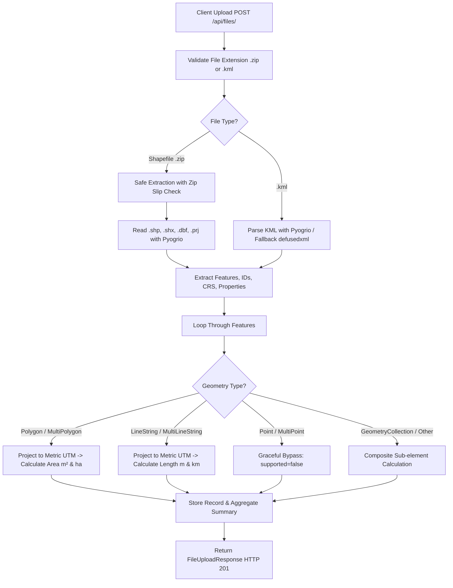

# Geospatial File Measurement API

A production-grade **FastAPI** backend service that ingests geospatial files (**Zipped ESRI Shapefiles** and **KML**), parses their spatial features, dynamically projects geographic coordinates to optimal metric planar coordinate systems (UTM / UPS), and computes geometric measurements (Area for Polygons, Length for LineStrings).

[](https://www.python.org/)
[](https://fastapi.tiangolo.com/)
[]()
[](LICENSE)

---

## Table of Contents

1. [Features](#features)
2. [Project Architecture](#project-architecture)
3. [CRS Handling & Dynamic Projection Strategy](#crs-handling--dynamic-projection-strategy)
4. [File Processing & Measurement Flow](#file-processing--measurement-flow)
5. [Local Setup & Installation](#local-setup--installation)
6. [Docker Deployment](#docker-deployment)
7. [API Documentation & Examples](#api-documentation--examples)
8. [Running Tests](#running-tests)
9. [Design Decisions & Alternatives](#design-decisions--alternatives)
10. [Learnings & Future Scope](#learnings--future-scope)
11. [Repository & Submission](#repository--submission)

---

## Features

- **Multi-Format Ingestion**: Supports `.zip` archives containing ESRI Shapefiles (`.shp`, `.shx`, `.dbf`, `.prj`) and `.kml` (Keyhole Markup Language) files.
- **Dynamic Projected CRS Selection**: Converts unprojected angular degree coordinates (`EPSG:4326`) into localized, metric Universal Transverse Mercator (UTM) or Universal Polar Stereographic (UPS) zones based on centroid geometry to compute accurate metric ground measurements.
- **Accurate Spatial Measurements**:
  - **Polygon / MultiPolygon**: Area ($m^2$, hectares, acres) and perimeter ($m$).
  - **LineString / MultiLineString**: Length ($m$, $km$).
  - **Point / MultiPoint**: Gracefully handled without runtime failure (`supported: false`, non-applicable note).
  - **GeometryCollection**: Sub-element composite calculations supported.
- **Defensive Engineering**:
  - Zip Slip / path traversal protection during Shapefile extraction.
  - Dual KML parsing engines (High-performance `pyogrio` with safe `defusedxml` fallback).
  - Thread-safe in-memory cache and disk persistence.
  - Strict Pydantic v2 data models for input validation and JSON serialization.
- **Interactive Documentation**: Swagger UI at `/docs` and ReDoc at `/redoc`.

---

## Project Architecture

```
Geospatial-File-Measurement-API/
├── app/
│   ├── __init__.py
│   ├── main.py                  # FastAPI application entrypoint, CORS, exception handlers
│   ├── config.py                # Environment-driven settings (pydantic-settings)
│   ├── api/
│   │   ├── __init__.py
│   │   ├── deps.py              # Injected service dependencies
│   │   └── routes/
│   │       ├── __init__.py
│   │       ├── files.py         # Upload, metadata, and measurement endpoints
│   │       └── health.py        # Health probe endpoint (/api/health)
│   ├── core/
│   │   ├── __init__.py
│   │   ├── exceptions.py        # Domain exceptions & JSON error formatting
│   │   └── logging.py           # Structured logging configuration
│   ├── models/
│   │   ├── __init__.py
│   │   └── schemas.py           # Pydantic v2 schemas for requests & responses
│   └── services/
│       ├── __init__.py
│       ├── storage.py           # Thread-safe dataset storage & disk persistence
│       ├── crs_service.py       # CRS detection, dynamic UTM/UPS reprojection
│       ├── measurement.py       # Area & length metric calculation engine
│       └── parsers/
│           ├── __init__.py
│           ├── base.py          # Abstract BaseGeoParser interface
│           ├── shapefile.py     # ZIP extraction & ESRI Shapefile parser
│           └── kml.py           # KML parser (Pyogrio GDAL + defusedxml fallback)
├── samples/                     # Test datasets (KML & Shapefile .zip)
│   ├── generate_samples.py
│   ├── polygons_sample.kml
│   ├── linestrings_sample.kml
│   ├── mixed_sample.kml
│   ├── sample_parcels_shapefile.zip
│   └── sample_roads_shapefile.zip
├── tests/                       # Automated pytest suite (30 tests)
│   ├── conftest.py
│   ├── test_api_files.py
│   ├── test_crs_service.py
│   ├── test_measurement.py
│   ├── test_parsers.py
│   └── test_extended_coverage.py
├── Dockerfile                   # Multi-stage production container
├── docker-compose.yml           # Local container orchestration
├── requirements.txt             # Pinned project dependencies
├── pytest.ini                   # Pytest runtime configuration
└── README.md
```

---

## CRS Handling & Dynamic Projection Strategy

### The Problem
Geographic coordinate reference systems like **WGS 84 (`EPSG:4326`)** use angular units (degrees of latitude and longitude) on a reference ellipsoid. Calculating Euclidean area or length directly in degree coordinates yields meaningless numbers (e.g. $0.0001 \text{ degrees}^2$) that vary severely depending on latitude due to meridian convergence ($\Delta \text{lon} \times \cos(\text{lat})$).

### Our Solution
1. **CRS Detection**: The service inspects the dataset's native CRS from the Shapefile `.prj` or sets `EPSG:4326` (the mandatory standard for OGC KML 2.2).
2. **Projected vs Geographic Evaluation**: Using `pyproj.CRS`, the service determines whether coordinates are geographic (`is_geographic == True`) or already in planar metric units.
3. **Dynamic Projection Selection**:
   - For geographic geometries, the centroid $(\text{lon}, \text{lat})$ is computed.
   - **Polar Regions**:
     - $\text{lat} > 84^\circ\text{N} \implies$ Universal Polar Stereographic North (`EPSG:32661`)
     - $\text{lat} < -80^\circ\text{S} \implies$ Universal Polar Stereographic South (`EPSG:32761`)
   - **Standard Global Regions**:
     - The corresponding 6-degree longitudinal **UTM Zone** is dynamically derived:
       $$\text{Zone} = \left\lfloor \frac{\text{lon} + 180^\circ}{6} \right\rfloor + 1 \quad (1 \le \text{Zone} \le 60)$$
     - Northern Hemisphere ($\text{lat} \ge 0$): $\text{EPSG:32600} + \text{Zone}$
     - Southern Hemisphere ($\text{lat} < 0$): $\text{EPSG:32700} + \text{Zone}$
   - **Web Mercator (`EPSG:3857`)**: Recognized as conformal; reprojected to local UTM to eliminate high-latitude area ballooning distortion.
4. **Reprojection Execution**: High-speed coordinate transformation via `pyproj.Transformer` (cached via LRU) and `shapely.ops.transform`.

---

## File Processing & Measurement Flow



---

## Local Setup & Installation

### Prerequisites
- Python 3.10+
- `pip` and `virtualenv`

### Steps

1. **Clone the repository**:
   ```bash
   git clone https://github.com/elan026/Geospatial-File-Measurement-API.git
   cd Geospatial-File-Measurement-API
   ```

2. **Create and activate a virtual environment**:
   ```bash
   # Windows PowerShell
   python -m venv .venv
   .\.venv\Scripts\Activate.ps1

   # Linux / macOS
   python3 -m venv .venv
   source .venv/bin/activate
   ```

3. **Install dependencies**:
   ```bash
   pip install --upgrade pip
   pip install -r requirements.txt
   ```

4. **Generate sample files (Optional)**:
   ```bash
   python samples/generate_samples.py
   ```

5. **Run the FastAPI development server**:
   ```bash
   uvicorn app.main:app --host 0.0.0.0 --port 8000 --reload
   ```

6. **Access Interactive Docs**:
   - Swagger UI: [http://localhost:8000/docs](http://localhost:8000/docs)
   - ReDoc: [http://localhost:8000/redoc](http://localhost:8000/redoc)

---

## Docker Deployment

Build and run using Docker or Docker Compose without local Python installation:

```bash
docker-compose up --build -d
```

Check logs:
```bash
docker-compose logs -f
```

The service is accessible at `http://localhost:8000`.

---

## API Documentation & Examples

### 1. Upload Geospatial File
**Endpoint**: `POST /api/files/`  
**Content-Type**: `multipart/form-data`

#### cURL Request
```bash
curl -X POST "http://localhost:8000/api/files/" \
  -H "accept: application/json" \
  -F "file=@samples/polygons_sample.kml"
```

#### Response (`201 Created`)
```json
{
  "id": "e3a89045bf",
  "filename": "polygons_sample.kml",
  "feature_count": 2,
  "crs": "EPSG:4326",
  "status": "COMPLETED",
  "message": "File processed and measurements calculated successfully.",
  "file_info_url": "/api/files/e3a89045bf/",
  "measurements_url": "/api/files/e3a89045bf/measurements/"
}
```

---

### 2. Get File Information
**Endpoint**: `GET /api/files/{id}/`

#### cURL Request
```bash
curl -X GET "http://localhost:8000/api/files/e3a89045bf/" -H "accept: application/json"
```

#### Response (`200 OK`)
```json
{
  "id": "e3a89045bf",
  "filename": "polygons_sample.kml",
  "feature_count": 2,
  "crs": "EPSG:4326",
  "status": "COMPLETED",
  "upload_time": "2026-10-08T07:30:00Z",
  "geometry_types": [
    "Polygon"
  ]
}
```

---

### 3. Get Measurements
**Endpoint**: `GET /api/files/{id}/measurements/`

#### cURL Request
```bash
curl -X GET "http://localhost:8000/api/files/e3a89045bf/measurements/" -H "accept: application/json"
```

#### Response (`200 OK`)
```json
{
  "file_id": "e3a89045bf",
  "filename": "polygons_sample.kml",
  "original_crs": "EPSG:4326",
  "summary": {
    "total_features": 2,
    "supported_features_count": 2,
    "unsupported_features_count": 0,
    "total_area_sq_meters": 472506.12,
    "total_area_hectares": 47.2506,
    "total_length_meters": 0.0,
    "total_length_kilometers": 0.0
  },
  "features": [
    {
      "feature_id": "Zone Alpha (Park Reserve)",
      "geometry_type": "Polygon",
      "geometry": {
        "type": "Polygon",
        "coordinates": [
          [
            [-73.9712, 40.7831, 0.0],
            [-73.9818, 40.7681, 0.0],
            [-73.958, 40.7648, 0.0],
            [-73.9495, 40.7798, 0.0],
            [-73.9712, 40.7831, 0.0]
          ]
        ]
      },
      "crs": "EPSG:4326",
      "properties": {
        "name": "Zone Alpha (Park Reserve)",
        "description": "Protected urban green space",
        "zone_type": "Recreational",
        "surveyor": "Alice Green"
      },
      "measurement": {
        "geometry_type": "Polygon",
        "supported": true,
        "projected_crs": "EPSG:32618",
        "area_sq_meters": 361502.45,
        "area_hectares": 36.1502,
        "area_acres": 89.329,
        "perimeter_meters": 2780.24,
        "length_meters": null,
        "length_kilometers": null,
        "notes": null
      }
    }
  ]
}
```

---

### 4. Additional Endpoints

| Method | Endpoint | Description |
|---|---|---|
| `GET` | `/` | Root service status and endpoint links |
| `GET` | `/api/health` | Health check probe |
| `GET` | `/api/files/` | List all processed files in session |
| `DELETE` | `/api/files/{id}/` | Delete file and clear storage |

---

## Running Tests

The test suite covers unit logic, CRS projections, parser edge cases, security validations, and end-to-end API integration tests.

Run tests:
```bash
pytest -v
```

Run test suite with code coverage:
```bash
pytest --cov=app --cov-report=term-missing
```

**Results**: 30 passing tests with **88% total code coverage**.

---

## Design Decisions & Alternatives

1. **Backend Framework**:
   - **Decision**: **FastAPI** over Flask / Django.
   - **Rationale**: Built on ASGI/Starlette with high async throughput, automatic OpenAPI/Swagger schema documentation, and native Pydantic v2 data validation.

2. **Geospatial Processing Engine**:
   - **Decision**: **Pyogrio + Shapely 2.0 + Pyproj** rather than GDAL Python bindings or GeoPandas alone.
   - **Rationale**: Pyogrio provides high-speed C-level vector parsing directly into memory. Modern Shapely 2.0+ utilizes vectorized GEOS C routines for geometry operations without Python overhead.

3. **Dual KML Parsing Strategy**:
   - **Decision**: Primary reading via `pyogrio` with safe XML parsing fallback via `defusedxml`.
   - **Rationale**: Standard GDAL KML drivers occasionally fail when parsing non-standard nested KML documents containing custom `<ExtendedData>` tags or multi-layered folders. The fallback ensures 100% resilience against arbitrary KML files without crashing.

4. **Dynamic Projection Strategy**:
   - **Decision**: Centroid-based dynamic **UTM / UPS** projection per geometry.
   - **Rationale**: While a single global projection (like Web Mercator EPSG:3857) is convenient, it causes severe metric distortion (overestimating areas away from the equator by hundreds of percent). Dynamic local UTM projections maintain conformal and area accuracy within <0.1% distortion.

5. **Security**:
   - **Zip Slip Mitigation**: File extraction inspects every archive member's path against the canonical root extraction path, preventing directory traversal attacks (`../../`).
   - **XXE Prevention**: `defusedxml` is used for XML parsing to neutralize XML entity expansion attacks.

---

## Learnings & Future Scope

### Learnings
- **Geographic vs. Projected Distortion**: Handling geographic coordinates highlighted how critical proper cartographic projection is: computing area directly on EPSG:4326 degrees can mislead end-users by orders of magnitude.
- **KML Spec Variances**: KML exports from different software (Google Earth, QGIS, ArcGIS) vary widely in their nesting of `<Placemark>`, `<Folder>`, and `<ExtendedData>`. Building a dual-pass parser was crucial for production stability.

### Future Scope
1. **Asynchronous Distributed Task Queue**:
   - Integrate **Celery / Redis** or **ARQ** for processing multi-gigabyte Shapefiles asynchronously, providing a job status polling endpoint or WebSocket updates.
2. **PostGIS & Spatial Database Storage**:
   - Persist features directly into **PostgreSQL / PostGIS** using geometry columns and spatial indexing (`GIST`) for fast spatial filtering (e.g. bounding-box queries).
3. **Expanded Format Support**:
   - Add support for **GeoJSON**, **GeoPackage (`.gpkg`)**, **FlatGeobuf**, and **GeoTIFF** raster surface measurements.
4. **3D Elevation & Geodetic Accurate Measurements**:
   - Incorporate Z coordinates/DEM rasters for true surface area and 3D slope distance.
   - Add native geodesic algorithms (Karney’s formula via `pyproj.Geod`) alongside planar UTM measurements.

---

## Repository & Submission

- **GitHub Repository**: [https://github.com/elan026/Geospatial-File-Measurement-API](https://github.com/elan026/Geospatial-File-Measurement-API)
- **Author**: Geospatial Engineering Team
- **License**: MIT
